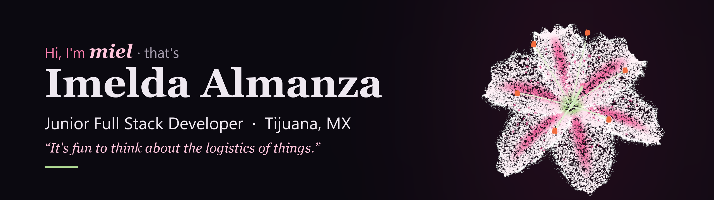

  

  
  
  
  

## 🌸 About me

I'm a full stack developer from Tijuana who has been programming since 2024 and doing freelance graphic design since 2023. That mix makes me care as much about how a system works as about how people use it.

- 🤖 Building **AI agents** with tool calling and hybrid RAG
- ⚡ Real-time systems and **offline-first** mobile apps
- 🎨 Turning messy processes into interfaces that feel simple

🇲🇽 Hola, soy desarrolladora full stack. Escríbeme en español o en inglés.

## 🌿 Featured projects

<table>
  <tr>
    <td width="50%" valign="top">
      <h3><a href="https://miel1144.github.io/presentacion-cosechia/">CosechIA</a></h3>
      
Vineyard management platform with a conversational <b>AI agent</b>: 20 tools validated with JSON Schema, hybrid RAG (pgvector + BM25) and proactive alerts.

      Laravel · Vue 3 · Inertia.js · PostgreSQL · pgvector
    </td>
    <td width="50%" valign="top">
      <h3><a href="https://github.com/miel1144/maquinaMonse">MONSE + MaquinaMonse</a></h3>
      
Real-time <b>energy monitoring</b>: an async API simulates power meters while MONSE receives, diagnoses and visualizes their readings for 4 user roles.

      FastAPI · Django · DRF · PostgreSQL
    </td>
  </tr>
  <tr>
    <td width="50%" valign="top">
      <h3><a href="https://miel1144.github.io/tonalli_web/">Tonalli</a></h3>
      
<b>Offline-first</b> app that uses the phone's light sensor to audit electricity use, predict CFE's high-consumption tariff and size solar panels.

      Flutter · Dart · SQLite
    </td>
    <td width="50%" valign="top">
      <h3><a href="https://miel1144.github.io/portfolio/#proyectos">kchin</a></h3>
      
Installable <b>PWA</b> to track loans, payments and balances inside groups, so shared money stays clear for everyone.

      Django · HTMX · PWA
    </td>
  </tr>
</table>

<a href="https://miel1144.github.io/portfolio/#proyectos">See all projects →</a>

## 🛠️ Tech stack

**Languages** 

**Frameworks** 

**Databases** 

**AI · Tools · Design** 

---

<i>Open to junior full stack roles and freelance projects · 🇬🇧 English B2 · 🇲🇽 Spanish native</i>

